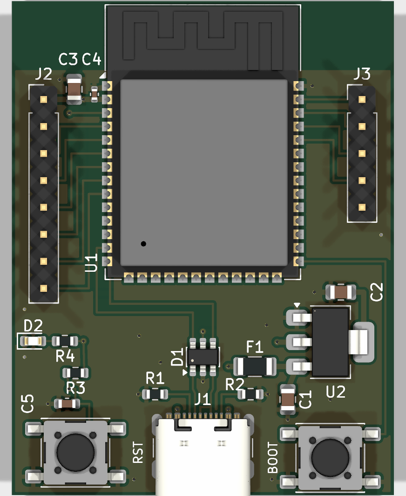
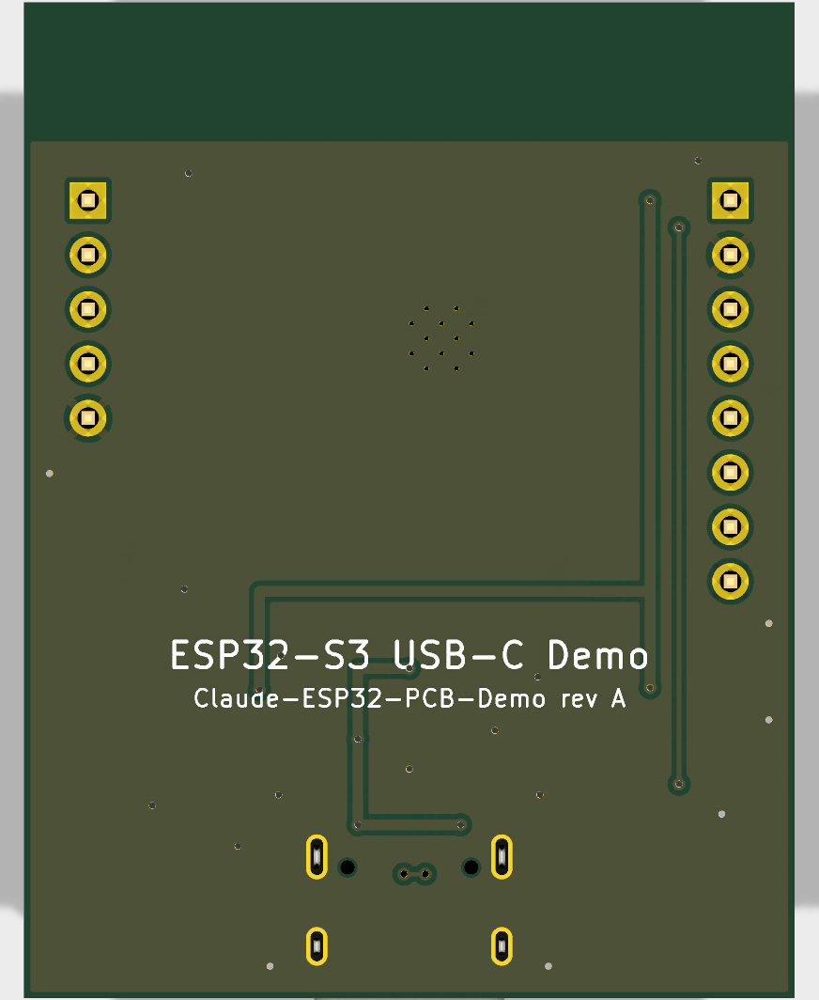

# Claude-ESP32-PCB-Demo

A small demo board built around an **ESP32-S3-WROOM-1** module, powered and
programmed over **USB-C** (native USB, no USB-UART bridge). Designed in KiCad 10.

| Top | Bottom |
|---|---|
|  |  |

Schematic: [hardware/docs/schematic.pdf](hardware/docs/schematic.pdf)

## Board

- 36 × 46.5 mm, 2 layers, GND pour on both sides; antenna overhangs a copper-free zone at the top edge
- USB-C receptacle (GCT USB4105), 5.1 kΩ CC pull-downs (sink, 5 V default)
- USBLC6-2SC6 ESD on D+/D−, routed through the ESP32-S3 native USB (GPIO19/20)
- 500 mA polyfuse → AMS1117-3.3 LDO, 10 µF in/out, 22 µF + 100 nF at the module
- RESET (EN, with 10 k / 1 µF RC) and BOOT (GPIO0) tact switches, power LED
- J2 (1×8): 3V3, GND, IO4, IO5, IO6, IO7, IO15, IO16
- J3 (1×5): IO1, IO2, TXD0, RXD0, GND

## Files

```
hardware/
  esp32s3-usbc/   KiCad project (.kicad_pro / .kicad_sch / .kicad_pcb)
  scripts/        generators that produce the schematic and board
  docs/           renders and schematic PDF
```

The schematic and layout are generated from `hardware/scripts/design.py`
(parts, footprints, nets, placement). To rebuild after editing it:

```bash
cd hardware/scripts
"C:/Program Files/KiCad/10.0/bin/python.exe" gen_schematic.py
"C:/Program Files/KiCad/10.0/bin/python.exe" gen_pcb.py
```

`gen_pcb.py` uses KiCad's bundled Python (`pcbnew`); routes are listed in its
`ROUTES` table. Regenerating overwrites the `.kicad_sch` / `.kicad_pcb`, so if
you start editing by hand in KiCad, stop using the scripts.

## Checks

- ERC: 0 violations
- DRC (with schematic parity): 0 errors, 0 unconnected. Remaining warnings are
  one silkscreen-over-pad nit and `ki_fp_filters` field-mismatch notices.

This is a quick demo, not a production-reviewed design: the USB pair is
short and length-matched but not impedance-controlled (fine for 12 Mbit/s
full-speed), and the AMS1117 has a high dropout, so 3V3 sags if VBUS drops
much below 4.5 V.
